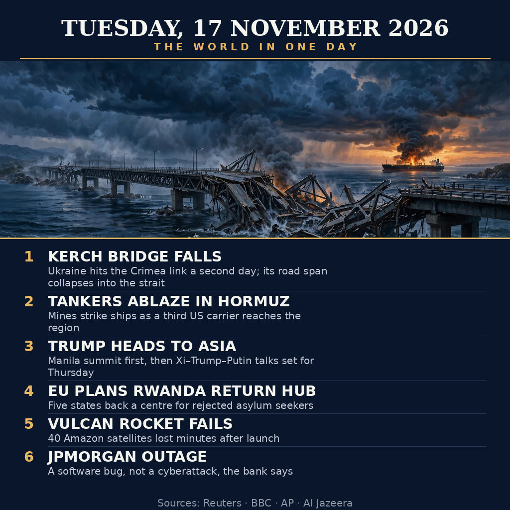

# The World in One Day — Tuesday, 17 November 2026

Entry for the [make.fun bounty "Sum up 17 November's world news in one image"](https://make.fun/bounty/news-image-20261117).

## The day's news

Six verified stories from Tuesday 17 November 2026, as reported by Reuters,
BBC, AP and Al Jazeera:

1. **Kerch Bridge falls** — Ukraine strikes the bridge linking Russia to
   occupied Crimea for a second straight day; video shows its road arch span
   collapsed into the Kerch Strait.
2. **Tankers ablaze in Hormuz** — mines strike tankers near the Strait of
   Hormuz as a third US aircraft carrier, USS Theodore Roosevelt, reaches
   the region.
3. **Trump heads to Asia** — arrives in Manila for the ASEAN summit, then on
   to Shenzhen, where a first three-way meeting with Xi Jinping and Vladimir
   Putin is set for Thursday.
4. **EU plans Rwanda return hub** — Germany, Denmark, Austria, Greece and the
   Netherlands back a joint centre in Rwanda for rejected asylum seekers.
5. **Vulcan rocket fails** — a ULA Vulcan launch fails minutes in, destroying
   40 Amazon Leo internet satellites.
6. **JPMorgan outage** — a software bug, not a cyberattack, disrupts the
   bank's online banking, branches and Zelle payments.

## How it runs

`main.py` (Python 3.13, standard library only) copies the bundled
`entry.png` to `/output/entry.png` (or `$MAKEFUN_OUTPUT_DIR/entry.png`).
It runs twice and writes byte-identical output both times.

## License

MIT — see [LICENSE](LICENSE).
